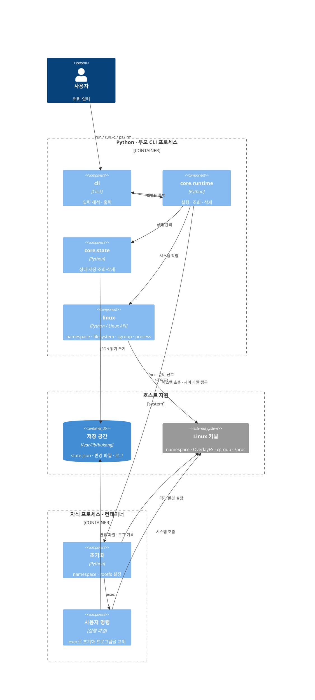

# bukang CLI blueprint

## concept

부캉이는 나가고 싶지 않다.

따라서 호스트와 격리된 환경이 필요하다(?) 격리에 필요한 것들을 부캉이가 친절하게 알려준다.

## runtime dependencies

- python 3.13+
  - cli layer: [Click](https://click.palletsprojects.com/)
- Linux · cgroup v2 · OverlayFS
- 준비된 rootfs 디렉터리와 memory controller가 활성화된 부모 cgroup

## Architecture

- `cli → core → linux`로 역할을 나눈다. CLI와 core는 같은 부모 프로세스에서 실행된다.
- 부모가 한 번 fork한 자식이 namespace와 rootfs를 설정하고, exec로 사용자 명령을 실행한다. 별도 감독 프로세스는 없다.
- core는 이벤트와 값을 콜백으로 전달하고, CLI가 부캉이 말투로 안내한다.
- PID·UTS·mount namespace, OverlayFS·pivot_root·procfs, cgroup v2 자원 제한을 사용한다.

### 계층별 C4 구성

초기화와 사용자 명령은 같은 자식 프로세스의 전후 단계다. exec는 프로세스를 추가하지 않는다.

## 주요 기능

| 명령 | 동작 |
| --- | --- |
| `bukang run` | 자식의 종료를 기다리고 종료 코드를 반환 |
| `bukang run -d` | 초기화 확인·상태 저장 후 부모 종료, 자식은 터미널에서 분리해 실행 |
| `bukang ps` | 저장된 PID·시작 시점·부팅 ID를 실제 프로세스와 대조해 실행 여부 표시 |
| `bukang rm` | 실행 중이면 거부하고, 종료된 컨테이너의 cgroup·작업 디렉터리·상태 삭제 |

## 저장 공간

- `/var/lib/bukang/containers/<UUID>/state.json`: 명령, 프로세스 식별 정보, 자원 경로
- `/var/lib/bukang/workspaces/<UUID>/`: OverlayFS의 upper·work·merged, 백그라운드 실행의 `container.log`
- cgroup은 지정한 부모 경로 아래 `<UUID>`로 생성한다. foreground 종료 시 삭제하고, 백그라운드 실행에서는 `rm`까지 남긴다.
- 백그라운드 실행의 stdin은 `/dev/null`에 연결한다. 자연 종료 후 종료 코드 기록이나 자동 정리는 하지 않는다.

## 현재 범위 밖

- 이미지 변환·다운로드: 준비된 rootfs를 입력으로 사용
- 네트워크 격리·bridge·포트 연결
- `stop`, 별도 터미널(PTY)
